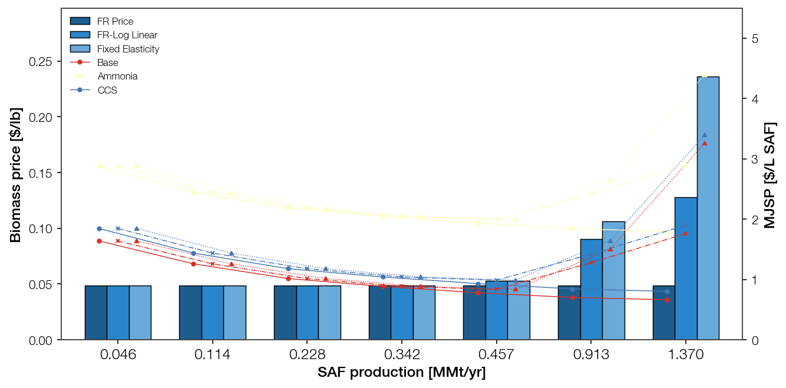
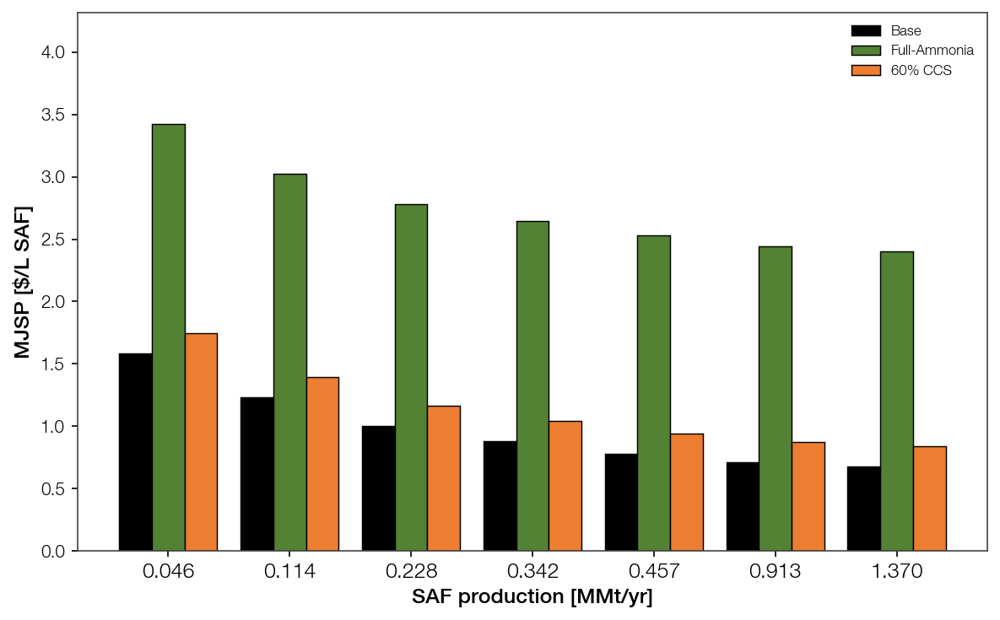

# 3.1. Scale-up and feedstock price

- Scaling the base process from 0.04 MMt/yr SAF production to 1.25 MMt/yr lowers MJSP into a third, from $1.46/L SAF to$0.54/L SAF.
  - Co-product revenue nearly is greater than the raw material cost at every scale. Therefore, MJSP effectively recovers only conversion costs (capital, utilities, and fixed operations), which are exactly the components that benefit from scale.
  - Capital investment accounts for a half of the reduction to 0.42 MMt/yr production scale. Utilities account for about a quarter, and fixed operating costs (labor, maintenance, overhead, G&amp;A) for most of the remainder.
  - Each doubling of capacity reduces MJSP by about 11% up to 0.42 MMt/yr, but by only about 3% beyond it. Scaling to 0.42 MMt/yr therefore captures nearly 90% of the total reduction achievable up to 1.25 MMt/yr.
  - The effective scaling exponent of capital investment rises from about 0.8 (under 0.42 MMt/yr) to about 1.0 (over 0.42 MMt/yr). This happens as the pyrolyzer, gas turbines, compressors, and expanders reach their single-train limits and multiply into parallel trains (Table 5).
- Therefore, the 0.42 MMt/yr production scale, about 10% of South Korea's domestic aviation fuel demand, marks the minimum efficient size (MES) of the pyrolysis-based SAF plant.
  - Identifying this MES depends on modeling single-train limits. A uniform 0.6 exponent would project roughly $0.25/L and implying that larger plants remain substantially cheaper.
  - Five MES-sized plants would produce SAF at only about 6% higher cost than a single 1.25 MMt/yr proudction plant. Biomass haulage costs grow with plant size and are not included here, so the practical optimum likely lies at or below 0.42 MMt/yr production scale. This favors numbering-up over larger single facilities.

- The scaling above holds the biomass price fixed at the forest-residue floor (0.0486 $/lb). Real feedstock supply curves raise the price once demand outgrows the local low-cost resource, so scale-up cannot draw an unlimited stream at the floor price. Three price models bracket this effect: **FR Price** (constant floor), **FR–Log Linear**, and **Fixed Elasticity** (the latter two rising supply curves fitted to Galik forest-residue and log resources).
  - Below ~0.4 MMt/yr all three coincide at the floor: demand stays within the forest-residue supply, so feedstock price is scale-invariant and the scale-up MJSP curves above are unchanged.
- **At the MES (0.457 MMt/yr, x10) the feedstock-price penalty is small.** Biomass rises 0.0486 → 0.0527 $/lb (+8.3%) under both supply-curve models, adding only ~$0.06/L to base MJSP (0.78 → 0.84 $/L; CCS 0.93 → 0.99; ammonia 1.94 → 1.99). The MES economics survive the switch from fixed to modelled feedstock price.
- **Beyond the MES the penalty reverses the scale benefit.** At 0.913 MMt/yr base MJSP climbs 0.70 → 1.28 (log-linear) / 1.50 (fixed elasticity), and at 1.37 MMt/yr 0.66 → 1.76 / 3.26 — versus the flat-price curve that keeps falling to 0.66. Because biomass is a shared feedstock, the CCS and ammonia configurations shift by the same delta (CCS 1.37 MMt/yr: 0.80 → 1.90 / 3.40; ammonia: 1.80 → 2.89 / 4.39).
- The rising feedstock cost of drawing supply from ever farther afield therefore **reinforces the ~0.42–0.46 MMt/yr MES**: past it, feedstock-price escalation compounds the flattening capital economy above and turns the MJSP curve upward. This strengthens the numbering-up case — several MES-sized plants, each on its own local feedstock base, avoid the supply-curve penalty that a single mega-plant incurs.

- At the MES, operating expenditures make up over 80% of gross production cost. The remaining cost and emission levers therefore lie in the hydrogen supply and process configuration rather than plant size.
- The base case relies on gray hydrogen and exceeds the SAF emission threshold, so $1.00/L is a lower bound for compliant SAF from this plant. The next subsection examines how much of this scale advantage survives the integration of green ammonia and CCS, and whether the MES shifts once those units are added.

# 3.2. Green ammonia and CCS integration

- Replacing grey hydrogen with green ammonia raises MJSP by about $1.7–1.8/L SAF at every scale, and this premium barely narrows with size (3.43 → 2.40 $/L SAF over 0.046 → 1.37 MMt/yr, against 1.58 → 0.68 for the base).
  - The ammonia-cracked hydrogen cost dominates the case, so scaling the plant does not close the gap. Green ammonia never reaches cost parity with grey hydrogen; its value is emissions depth, not cheaper fuel.
- Adding 60% CCS to the grey-H2 base carries a nearly flat +$0.16/L SAF premium that is independent of scale (1.74 → 0.84 $/L SAF, tracking the base curve down).
  - Capture cost is proportional to the CO2 captured, which itself scales with plant size, so — unlike whole-plant capital — the capture unit earns no economy of scale. CCS lowers absolute MJSP only by riding the base scale-up curve, not by becoming cheaper per tonne captured.
- Because both add-ons are scale-invariant relative to the base (grey-H2 variable cost sets a hard floor, and the CCS premium is constant), neither shifts the MES: the ~0.42 MMt/yr knee of §3.1 still governs. Integrating green ammonia or CCS changes the level of MJSP, not the scale at which further scale-up stops paying.

- WTWa GHG-100 intensity is fixed by the life-cycle inventory per MJ of SAF and is therefore scale-independent; total annual emissions scale linearly with production. The per-subunit intensities (allocation method) are:
  - Grey-H2 base: 87.6 g CO2e/MJ — above the CORSIA threshold (75.9 g CO2e/MJ, 0.9× conventional jet), so the base fuel is non-compliant at any scale.
  - Full green ammonia: 49.5 g CO2e/MJ, a 44% cut versus base — the deeper of the two levers.
  - 60% CCS: 60.3 g CO2e/MJ, a 31% cut. Both integrated configurations clear the CORSIA threshold at every scale, whereas the base does not.

- Total annual GHG emissions by subunit configuration and production scale [Mt CO2e/yr, WTWa allocation]:

| SAF [MMt/yr] | Base | + Green ammonia | + CCS (60%) |
|-------------:|-----:|----------------:|------------:|
| 0.046        | 0.18 | 0.10            | 0.12        |
| 0.114        | 0.45 | 0.25            | 0.31        |
| 0.228        | 0.90 | 0.51            | 0.62        |
| 0.342        | 1.34 | 0.76            | 0.93        |
| 0.457        | 1.79 | 1.01            | 1.23        |
| 0.913        | 3.58 | 2.02            | 2.47        |
| 1.370        | 5.37 | 3.03            | 3.70        |

<!-- Totals = intensity (above) x SAF energy, LHV 44.8 MJ/kg. CCS-60% intensity is
     linearly interpolated from the 50%/75% capture WTWa points; base and full-ammonia
     intensities are read directly from the LCA (allocation). -->

- At the MES (~0.42 MMt/yr) the plant emits ≈1.8 Mt CO2e/yr on grey hydrogen; full green ammonia brings this to ≈1.0 Mt/yr and 60% CCS to ≈1.2 Mt/yr. Scaling on to 1.37 MMt/yr triples the absolute burden (5.4 / 3.0 / 3.7 Mt/yr). The emissions case for the hydrogen-supply and CCS levers therefore strengthens in absolute terms exactly where the scale-up economics flatten, reinforcing that the remaining decarbonization levers lie in configuration rather than plant size.

