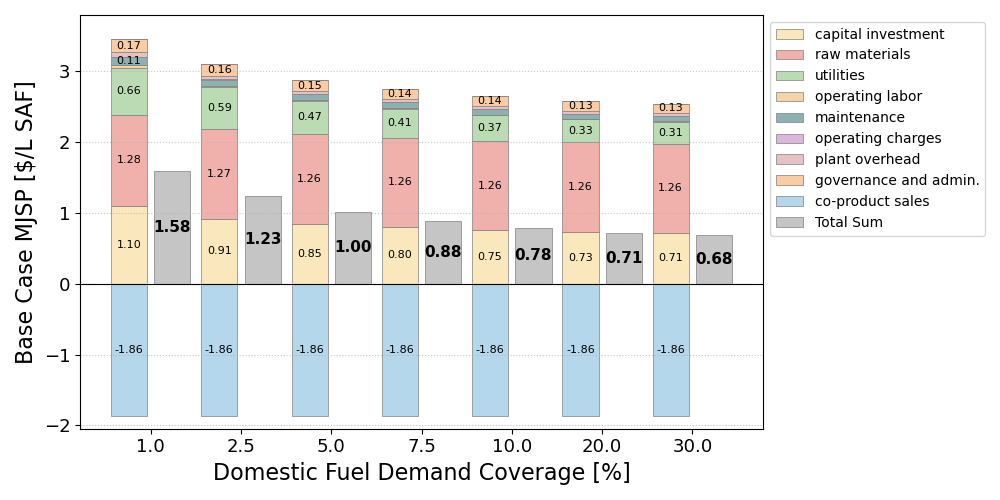

# 3. 1. Scale-up

- Scaling the base process from 0.04 MMt/yr SAF production to 1.25 MMt/yr lowers MJSP into a third, from $1.46/L SAF to$0.54/L SAF.
  - Co-product revenue nearly is greater than the raw material cost at every scale. Therefore, MJSP effectively recovers only conversion costs (capital, utilities, and fixed operations), which are exactly the components that benefit from scale.
  - Capital investment accounts for a half of the reduction to 0.42 MMt/yr production scale. Utilities account for about a quarter, and fixed operating costs (labor, maintenance, overhead, G&amp;A) for most of the remainder.
  - Each doubling of capacity reduces MJSP by about 11% up to 0.42 MMt/yr, but by only about 3% beyond it. Scaling to 0.42 MMt/yr therefore captures nearly 90% of the total reduction achievable up to 1.25 MMt/yr.
  - The effective scaling exponent of capital investment rises from about 0.8 (under 0.42 MMt/yr) to about 1.0 (over 0.42 MMt/yr). This happens as the pyrolyzer, gas turbines, compressors, and expanders reach their single-train limits and multiply into parallel trains (Table 5).
- Therefore, the 0.42 MMt/yr production scale, about 10% of South Korea's domestic aviation fuel demand, marks the minimum efficient size (MES) of the pyrolysis-based SAF plant.
  - Identifying this MES depends on modeling single-train limits. A uniform 0.6 exponent would project roughly $0.25/L and implying that larger plants remain substantially cheaper.
  - Five MES-sized plants would produce SAF at only about 6% higher cost than a single 1.25 MMt/yr proudction plant. Biomass haulage costs grow with plant size and are not included here, so the practical optimum likely lies at or below 0.42 MMt/yr production scale. This favors numbering-up over larger single facilities.

- At the MES, operating expenditures make up over 80% of gross production cost. The remaining cost and emission levers therefore lie in the hydrogen supply and process configuration rather than plant size.
- The base case relies on gray hydrogen and exceeds the SAF emission threshold, so $1.00/L is a lower bound for compliant SAF from this plant. The next subsection examines how much of this scale advantage survives the integration of green ammonia and CCS, and whether the MES shifts once those units are added.

# 3.2.

