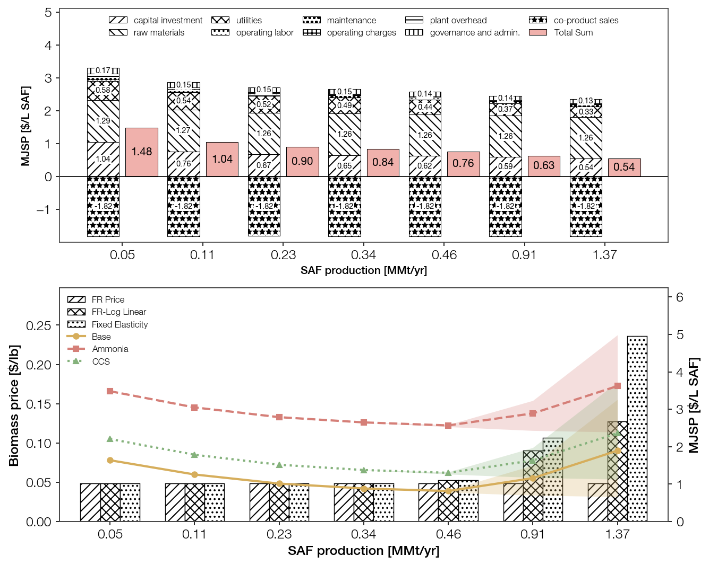

# 3.1. Scale-up and feedstock price

The cheapest plant size follows from two opposing forces: scale lowers conversion cost with sharply diminishing returns, while a realistic feedstock supply curve raises biomass cost as the plant grows. Their crossover fixes the minimum-MJSP scale at x10 (0.457 MMt/yr).

**Step 1 — Scale lowers MJSP, but the return fades by ~x10.** Scaling the base process from 0.04 to 1.25 MMt/yr SAF cuts MJSP to a third, \$1.46 → \$0.54/L SAF (SI Table S9-1).

- Co-product revenue exceeds raw-material cost at every scale, so MJSP recovers only conversion cost — capital, utilities, fixed operations — which are exactly the scale-sensitive components. Capital investment supplies about half the reduction up to 0.42 MMt/yr, utilities about a quarter, and fixed operating costs (labor, maintenance, overhead, G&amp;A) most of the rest.
- The return is front-loaded: each capacity doubling cuts MJSP ~11% below 0.42 MMt/yr but only ~3% above it, so 0.42 MMt/yr already captures ~90% of the total reduction available up to 1.25 MMt/yr. The capital scaling exponent rises from ~0.8 to ~1.0 across that point as the pyrolyzer, gas turbines, compressors, and expanders hit single-train limits and multiply into parallel trains (Table 5).
- This defines the minimum efficient size (MES): ~0.42 MMt/yr, about 10% of South Korea's domestic aviation-fuel demand. (The MES hinges on modeling those single-train limits — a uniform 0.6 exponent would instead project ~\$0.25/L and favor ever-larger plants.)

**Step 2 — Feedstock price, flat above, turns against larger scales.** Step 1 held biomass at the forest-residue floor (\$0.0486/lb); real supply curves raise it once demand outgrows the local low-cost resource. Three models bracket the effect: **FR Price** (constant floor), **FR–Log Linear**, and **Fixed Elasticity** (the latter two rising curves fitted to Galik forest-residue and log resources; SI Tables S9-2, S9-3).

- Below ~0.4 MMt/yr all three coincide at the floor: demand stays inside the forest-residue supply, feedstock price is scale-invariant, and the Step 1 curves are unchanged.
- At x10 (0.457 MMt/yr) the penalty is still small — biomass rises \$0.0486 → \$0.0527/lb (+8.3%), adding only ~\$0.06/L (base 0.78 → 0.84 \$/L).
- Beyond x10 the penalty reverses the scale benefit: at 0.913 MMt/yr base MJSP climbs 0.70 → 1.28 (log-linear) / 1.50 (fixed elasticity), and at 1.37 MMt/yr 0.66 → 1.76 / 3.26, versus the flat-price curve still falling to 0.66. Biomass is shared, so CCS and ammonia shift by the same delta.

**Step 3 — The two forces cross at x10, making it the cheapest scale.** Below x10 scale cuts cost faster than feedstock rises; above x10 feedstock rises faster than scale saves. Under any rising supply curve the net MJSP minimum therefore sits at x10 (0.457 MMt/yr) — only the flat-price model, which ignores supply-curve escalation, keeps favoring bigger plants.

- This reinforces numbering-up over a single mega-plant: several MES-sized plants, each on its own local feedstock base, cost only ~6% more than one 1.25 MMt/yr plant while avoiding both the supply-curve penalty and the haulage cost (excluded here) that grow with size, so the practical optimum lies at or below 0.42 MMt/yr.
- At this scale operating expenditure is over 80% of gross production cost, so the remaining cost and emission levers lie in hydrogen supply and process configuration, not plant size. The base case runs on grey hydrogen and exceeds the SAF emission threshold, making ~\$1.00/L a lower bound for compliant fuel.

# 3.2. Cost–emission trade-off of hydrogen source and CCS

With the plant fixed at 0.457 MMt/yr SAF, the two decarbonization levers, green-ammonia hydrogen and CCS, span a cost–emission space from \$0.79/L at 100.8 g CO₂e/MJ to \$3.09/L at 21.9 g CO₂e/MJ: a 4.6-fold GHG cut for a 3.9-fold MJSP rise. CCS is the cheaper lever per gram of GHG removed, and CCS alone reaches CORSIA compliance at the lowest cost.

**Step 1 — The two levers bend the grid differently.** The 6 × 5 grid crosses green-NH₃ hydrogen share (0, 10, 25, 50, 75, 100%) with CCS portion (0, 25, 50, 75, 100%) (Figure Xa; SI Table S9-4).

- Green NH₃ acts linearly. Every +10% share cuts GHG by 3.81 g CO₂e/MJ and raises MJSP by \$0.185/L at every CCS level, a constant \$0.049/L per g CO₂e/MJ. The iso-CCS lines are therefore straight and parallel.
- CCS bends once, at 50% capture. CCS 0 → 50% removes 21.8 g CO₂e/MJ for +\$0.12/L (\$0.006/L per g); CCS 50 → 100% removes a further 19.0 g CO₂e/MJ for +\$0.42/L (\$0.022/L per g). The kink sits at the same capture fraction on every iso-NH₃ line.
- Per gram of GHG removed, low-range CCS is ~8 times and high-range CCS ~2 times cheaper than green NH₃. The low-cost edge of the space is the zero-NH₃ CCS ladder, continued by the CCS 100% line toward full NH₃.

**Step 2 — CCS alone clears CORSIA at the lowest cost.** The CORSIA threshold, 0.9 × the conventional-jet WTWa intensity, is 75.93 g CO₂e/MJ. The grey-H₂ base (100.8 g CO₂e/MJ) misses it.

- CCS-only crosses the threshold at ~58% capture. CCS 60% (75.14 g CO₂e/MJ, \$0.977/L) is the cheapest compliant configuration; its GHG is interpolated between the simulated CCS 50% and 75% points (SI §S7). It undercuts the cheapest compliant grid points, Green NH₃ 10% + CCS 50% (75.18 g CO₂e/MJ, \$1.098/L) and CCS 75% (69.36 g CO₂e/MJ, \$1.111/L), by ~\$0.12/L.
- This confirms the ~\$1.00/L lower bound for compliant fuel set in §3.1, and shows it needs no green NH₃.
- Compliance through green NH₃ alone needs at least a 75% share, at \$2.12/L, about twice the CCS-led routes.

**Step 3 — Below the threshold, CCS first and green NH₃ last.** Regulation forces a producer only as far as CCS 60%, so abatement beyond compliance is costed against that point (ΔMJSP / ΔGHG, E = 31.66 MJ/L).

- Deepening CCS on grey H₂ is the cheapest further step: \$733/t CO₂ to CCS 75% (69.36 g CO₂e/MJ) and \$742/t CO₂ to CCS 100% (59.96 g CO₂e/MJ).
- Adding green NH₃ forms the expensive tail, ~\$900–1360/t CO₂ from 10% to 100% share on the CCS 75% and 100% lines; full NH₃ with CCS 100% reaches 21.9 g CO₂e/MJ at \$1250/t CO₂.

# 3.3. Sensitivity of the trade-off

Hydrogen price, not the choice of lever, sets the uncertainty of the §3.2 trade-off.

Applying the tornado ranges (§2.2.4) to each configuration gives wide, upward-skewed MJSP ranges driven by grey-H₂ and NH₃ prices: \$0.55–1.84/L for the grey base and \$1.91–4.26/L for full NH₃ with CCS 100%. The biomass price range is bounded by the price-model span at this scale (\$0.0486–0.0527/lb, §3.1).

- The ranges of neighbouring configurations overlap heavily. At unfavourable H₂ and NH₃ prices the cost gap between grey-H₂ + CCS and green-NH₃ routes narrows or closes, so the §3.2 ordering is a central estimate, not a guarantee.
- At the favourable end (cheap H₂, high capacity factor) the trade-off keeps its shape and shifts down ~\$0.3/L.

**SHAP attribution at the two compliance points.** The SHAP beeswarms (Figure Xc, d; SI Table S9-6) attribute MJSP across all drivers sampled jointly (Latin hypercube, 128 TEA runs per point; gradient-boosted surrogate, R² > 0.999). They compare the cheapest CCS-only compliant point, CCS 60%, with the cheapest compliant point that uses green NH₃, Green NH₃ 10% + CCS 50%.

- Grey-H₂ price is the strongest lever in both cases, with mean |SHAP| of \$0.310/L at CCS 60% and \$0.274/L at Green NH₃ 10% + CCS 50%, about three times the next driver. High H₂ prices push MJSP up and low prices pull it down, which forms the long horizontal spread in both panels. CCS 60% leans on it harder because all of its hydrogen is grey, against 90% in the NH₃ case.
- CAPEX (\$0.10/L), co-product price (\$0.08–0.10/L) and electricity (\$0.05/L) follow, nearly the same in both cases. Capacity factor (\$0.02–0.03/L) and biomass (\$0.002–0.003/L, narrow supply-curve band) are negligible.
- CO₂ T&S is the factor specific to CCS. It stays minor in both cases, at \$0.025/L for CCS 60% and \$0.023/L for Green NH₃ 10% + CCS 50%, and is slightly larger at CCS 60% because more CO₂ is captured.
- Green NH₃ price appears only in the Green NH₃ 10% + CCS 50% case (\$0.031/L). Because ammonia supplies only 10% of the hydrogen, it takes over a small slice of the grey-H₂ exposure rather than adding a new major risk.
- The choice of compliance route therefore does not change what governs MJSP uncertainty: in both cases it is the hydrogen price, and the factors specific to each route (CO₂ T&S, green NH₃) are second-order.

**When green NH₃ beats CCS-only.** Of the two route-specific factors, green NH₃ price matters more than CO₂ T&S. Its one-at-a-time MJSP span is \$0.234/L over 270–1000 \$/t NH₃, against \$0.165–0.187/L for CO₂ T&S over 4–45 \$/t CO₂ (SI Table S9-7). It also moves the crossover between the two routes far more: across the ammonia range the crossover shifts by about 5.6 \$/kg H₂, whereas the full CO₂ T&S range shifts it by no more than ~0.45 \$/kg H₂. Figure Xb therefore plots the MJSP of the two compliance routes against grey-H₂ price, with one Green NH₃ 10% + CCS 50% line per green-NH₃ price.

- The two lines differ in slope because the routes depend on grey H₂ to different degrees. CCS-only runs entirely on grey H₂ and climbs at \$0.419/L per \$/kg H₂. The NH₃ route is 90% grey and climbs at \$0.378/L per \$/kg H₂. As grey H₂ becomes more expensive the gap closes, until the NH₃ route becomes the cheaper one.
- The crossover point depends on the green-NH₃ price: it lies at a grey-H₂ price of 1.59 \$/kg at 270 \$/t NH₃, 2.91 \$/kg at 441 \$/t, 4.40 \$/kg at the base price of 635 \$/t, and 7.21 \$/kg at 1000 \$/t (SI Table S9-5). Only the two cheapest ammonia cases cross inside the 1–4 \$/kg range examined (dots).
- At base prices (grey H₂ 1.50 \$/kg, green NH₃ 635 \$/t), CCS-only stays cheaper across the whole grey-H₂ range. The NH₃ route becomes competitive only if grey H₂ becomes expensive, for example through natural-gas price shocks or carbon pricing on SMR, or if the green-NH₃ price falls below ~450 \$/t, where the crossover moves to a grey-H₂ price under 3 \$/kg.

