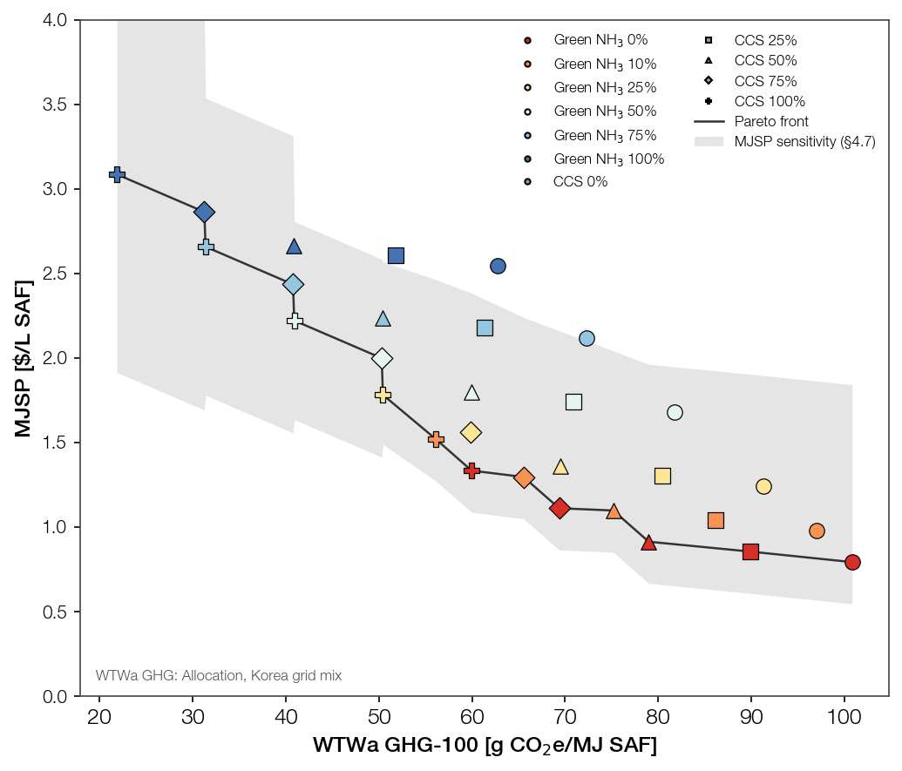
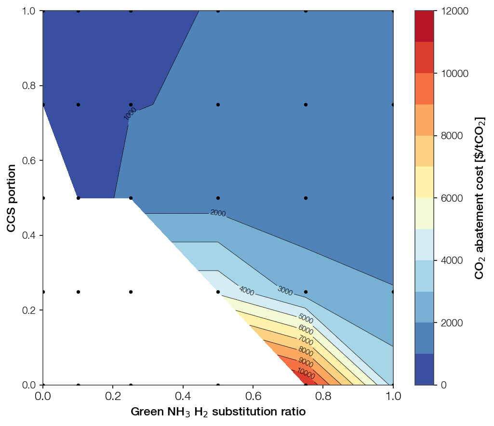

# Pareto Front — MJSP vs GHG (ammonia cracker × CCS scale)

Two-objective trade-off (minimize MJSP, minimize WTWa GHG) for the SAF pyrolysis
process, main unit fixed at scale **x10** (MJSP economies-of-scale knee), sweeping
ammonia-cracker scale and CCS portion. 551 basis, Allocation LCA, **Korea grid mix**.

Script: `tea_pareto_front.py` → `Figure/pareto_front.png`, `Result/pareto_front.xlsx`.

## 1. Objective & Grid Design

- **Objectives** (both minimized): MJSP [$/L SAF]; WTWa GHG-100 [g CO₂e/MJ SAF].
- **Fixed**: main SAF process unit at x10 (knee point of the MJSP scale-up curve).
- **Grid (6 × 5 = 30)**:
  - Ammonia cracker scale: x0, x1, x2.5, x5, x7.5, x10 — where **x0 = full grey-H₂** (no cracker).
  - CCS portion: 0%, 25%, 50%, 75%, 100%.
- **Ammonia scale → H₂ share**: at an x10 plant a cracker of scale x_a supplies x_a/10 of
  the H₂ demand, so `ammonia_portion = x_a / 10` (x0 → 0, x10 → full ammonia). This makes
  the cracker-scale axis a partial-substitution axis, not an oversizing axis.

## 2. Method

- **MJSP** — `funs.TEA.economic_analysis` at `Scale0100`. For x0, the grey `Base` row; for
  x1–x10, the `Mix` row (partial grey/ammonia H₂ **with CCS applied at the same portion**).
  No engine change. CO₂ T&S = **$10/tCO₂** (current basis, commit 95db93c).
- **GHG** — `funs_lca.get_WTWa_pyrolysis`, GHG-100, **Allocation method, Korea grid mix**
  (`Pyrolysis_551_LCA_Allocation_KRmix.xlsx`, *not* the US-mix / Displacement variants; base
  100.83 g/MJ = the KR-Allocation value, vs 87.57 for US-Allocation). CCS uses the per-portion LCA
  sheets (`Base`, `CCS025/050/075/100` — no interpolation). The ammonia lever is applied as an
  additive delta from base:
  `GHG(a,c) = ghg_ccs[c] − a·(ghg_base − ghg_ammonia)`.
  - **Assumption**: ammonia-H₂ abatement (removing upstream grey-H₂/SMR emissions) is
    independent of, and additive to, CCS process-CO₂ capture — they act on largely different
    emission sources. Cross-terms not modelled (no combined ammonia+CCS LCA case exists).
- **Pareto front**: non-dominated set minimizing both objectives (15 of 30 points under KR mix).

## 3. Results

Colour = ammonia scale; marker = CCS portion; line = Pareto front.

**Pareto-optimal points** (grey-end cheap → ammonia-end clean):

| Green NH₃ | CCS | GHG [g CO₂e/MJ] | MJSP [$/L] |
|-----------|-----|-----------------|------------|
| 0%   | 0%   | 100.83 | 0.793 |
| 0%   | 25%  |  89.93 | 0.855 |
| 0%   | 50%  |  78.99 | 0.913 |
| 10%  | 50%  |  75.18 | 1.098 |
| 0%   | 75%  |  69.36 | 1.111 |
| 10%  | 75%  |  65.55 | 1.296 |
| 0%   | 100% |  59.96 | 1.334 |
| 10%  | 100% |  56.15 | 1.518 |
| 25%  | 100% |  50.44 | 1.782 |
| 50%  | 75%  |  50.31 | 1.998 |
| 50%  | 100% |  40.91 | 2.221 |
| 75%  | 75%  |  40.78 | 2.435 |
| 75%  | 100% |  31.39 | 2.657 |
| 100% | 75%  |  31.26 | 2.863 |
| 100% | 100% |  21.86 | 3.085 |

Full 30-point grid in `Result/pareto_front.xlsx`. (MJSP is identical to the US-mix run — the LCA
method changes only the GHG axis, hence the front membership; the economics are untouched.)

**CORSIA-compliance floor.** The regulatory line is **75.9 g CO₂e/MJ** (0.9 × conventional-jet
WTWa, CORSIA −10%; unchanged — it is set by conventional jet, not the grid mix). Under the Korea
grid the pyrolysis base is dirtier (100.8 g/MJ), so **CCS25 (89.9) and CCS50 (79.0) both miss the
line** — the US-mix CCS-only compliance route no longer holds. The cheapest compliant point is now
**10% green NH₃ + CCS50 (75.18 g/MJ, 1.098 $/L)**, taken as the **compliance floor** (the point a
producer is forced to, and the reference for §5). CCS75-only clears the line too (69.4 g/MJ) at
essentially the same cost (1.111 $/L). So under KR mix the mandate demands **either CCS ≥ 75% or
CCS50 plus ~10% green ammonia** — materially deeper decarbonization than the US-mix CCS25 floor.

## 4. Reading the trade-off

- **Front spans 0.79 → 3.09 $/L for 100.8 → 21.9 g CO₂e/MJ** — a ~4.6× GHG cut costs ~3.9× MJSP.
- **CCS is still the efficient near-term lever.** From grey-no-CCS, ramping CCS 0→100% (all at 0%
  ammonia) stays on or near the front down to 60 g at 1.33 $/L. But under the dirtier KR base the
  cheapest CCS-only points now need CCS75/100 to reach the mid-front.
- **Ammonia enters the front earlier than under US mix.** Because CCS-only cannot clear the mandate,
  the deep-decarbonization tail is **CCS75/CCS100 + rising ammonia scale** — the front now carries
  CCS75 points (50/75/100% NH₃) as well as the CCS100 ladder. Ammonia no longer waits for CCS100.
- **Knee of the front** is around the 10%/CCS50 → 0%/CCS75 region (69–75 g, ~1.10 $/L): the
  compliance floor itself, just before the ammonia cost tail steepens.
- This is a first scatter at base green-ammonia price ($0.288/lb) and $10/tCO₂ T&S; both move
  the ammonia and CCS tails respectively (see `_Tornado_Sensitivity.md` ranges).

## 5. CO₂ abatement cost (vs the CORSIA-compliance floor)

Marginal cost of decarbonizing **below the compliance floor** — **10% green NH₃ + CCS50** (§3), the
cheapest CORSIA-compliant point under the Korea grid. Regulation forces a producer only as far as
the floor; every reduction beyond it is voluntary, so the floor — not the dirty grey base — is the
reference: `abatement = ΔMJSP / (ΔGHG · E) · 10⁶` [$/tCO₂], `E = 31.66 MJ/L SAF` (§3b), with ΔMJSP
and ΔGHG taken against the floor (75.18 g/MJ, 1.098 $/L). Points at or above the floor are
non-abating (n/a). The floor is selected dynamically as the cheapest compliant run (not hardcoded),
so it tracks the LCA basis. Same formula as `tea_scale_up_abatement.py`. Full grid in
`Result/pareto_front.xlsx` (`abatement` column, rebased).

**Pareto-front points** — first row is the compliance floor (reference); the rest lie below it and
carry a marginal abatement cost:

| Green NH₃ | CCS | GHG [g/MJ] | MJSP [$/L] | Abatement [$/tCO₂] |
|-----------|-----|------------|------------|--------------------|
| 10%  | 50%  | 75.18 | 1.098 | 0 (floor) |
| 0%   | 75%  | 69.36 | 1.111 | 74 |
| 10%  | 75%  | 65.55 | 1.296 | 649 |
| 0%   | 100% | 59.96 | 1.334 | 490 |
| 10%  | 100% | 56.15 | 1.518 | 698 |
| 25%  | 100% | 50.44 | 1.782 | 873 |
| 50%  | 75%  | 50.31 | 1.998 | 1144 |
| 50%  | 100% | 40.91 | 2.221 | 1035 |
| 75%  | 75%  | 40.78 | 2.435 | 1228 |
| 75%  | 100% | 31.39 | 2.657 | 1125 |
| 100% | 75%  | 31.26 | 2.863 | 1269 |
| 100% | 100% | 21.86 | 3.085 | 1177 |

- **Cheapest step below the floor = grey + CCS75 at 74 $/tCO₂** — deepen CCS on grey H₂. The next
  grey-CCS step, CCS100 (60 g/MJ), costs 490 $/t (the last tonnes of capture cost most).
- **Green ammonia is the expensive tail: ~650 → 1270 $/tCO₂** (10%→100% share, at CCS75/CCS100). It
  only pays once grey+CCS100 (60 g/MJ) is exhausted and deeper cuts are still needed.
- CCS on grey H₂ is the cheapest abatement lever near the floor; ammonia is always dearer per tonne.
  The deepest option (full green NH₃ + CCS100) reaches 21.9 g/MJ at ~1180 $/t.

Contour over the grid (x = green-NH₃ H₂ substitution ratio, y = CCS portion; dots = the 30 sampled
points). The floor (10% NH₃ + CCS50) is coloured as the **0 $/tCO₂ reference**; cells *above* it
(GHG > 75.18 g/MJ — the grey base and the low-CCS/low-NH₃ corner, now a larger blank region than
under US mix) are non-abating. Below the floor the cheapest tonnes still lie toward the **CCS axis**
— deepening CCS; cost climbs steeply as green ammonia is added. Same message as the table:
**CCS first, ammonia last — but under KR mix the floor itself already sits at deep CCS.**

## 6. MJSP sensitivity on the frontier

Error bars on each Pareto-front point apply the §4.7 tornado conditions
(`_Tornado_Sensitivity.md`) to the **Mix** points, reusing `tea_tornado.py` constants,
**except biomass**: since this front is fixed at the x10 plant (0.457 MMt/yr SAF), the
biomass price range is the supply-curve price-model span *at that scale* — FR-price floor
**0.0486 → galik 0.0527 $/lb (+8.3%)**, one-sided up (FR is the floor), replacing the
generic ±50% swing (§3.1, `tea_scale_up_price_models.py`). Other knobs unchanged: gray H₂
1–4 $/kg (on the grey share 1−a), green NH₃ 0.12–0.45 $/lb (on the ammonia share a), CAPEX
±30%, CO₂ T&S 4–45 $/tCO₂ (CCS points), electricity ±30%, co-product ±20%, capacity 85/91%.
Bar = envelope (min…max) of the one-at-a-time swings. Table `Result/pareto_front_sensitivity.xlsx`.

| Green NH₃ | CCS | MJSP [$/L] | MJSP low | MJSP high |
|-----------|-----|------------|----------|-----------|
| 0%   | 0%   | 0.793 | 0.55 | 1.84 |
| 0%   | 25%  | 0.855 | 0.61 | 1.90 |
| 0%   | 50%  | 0.913 | 0.67 | 1.96 |
| 10%  | 50%  | 1.098 | 0.85 | 2.04 |
| 0%   | 75%  | 1.111 | 0.86 | 2.16 |
| 10%  | 75%  | 1.296 | 1.05 | 2.24 |
| 0%   | 100% | 1.334 | 1.09 | 2.38 |
| 10%  | 100% | 1.518 | 1.27 | 2.46 |
| 25%  | 100% | 1.782 | 1.49 | 2.57 |
| 50%  | 75%  | 1.998 | 1.41 | 2.58 |
| 50%  | 100% | 2.221 | 1.64 | 2.81 |
| 75%  | 75%  | 2.435 | 1.56 | 3.31 |
| 75%  | 100% | 2.657 | 1.78 | 3.54 |
| 100% | 75%  | 2.863 | 1.69 | 4.03 |
| 100% | 100% | 3.085 | 1.91 | 4.26 |

(MJSP columns are LCA-method-independent — identical to the US-mix run; only the set of
front rows changes with the GHG axis.)

- **Bars are wide and upward-skewed**, driven by the hydrogen price (gray H₂ 1–4 $/kg or
  green NH₃ 0.12–0.45 $/lb) — the same conclusion as `_Tornado_Sensitivity.md`. Every point
  can reach ~1.8–2.4 $/L at the high-H₂-price end; the ammonia-heavy points widen most
  (full-NH₃+CCS100 spans 1.9–4.3 $/L).
- **Frontier ordering is not robust to H₂ price**: the sensitivity ranges of adjacent points
  overlap heavily, so at unfavourable H₂/NH₃ prices the cost gap between grey+CCS and green-NH₃
  routes narrows or collapses. The mean-price front is the central estimate, not a guarantee.
- The low end of each bar (cheap H₂, high capacity) keeps the trade-off shape but shifts the
  whole front down ~0.3 $/L.
- **Bars are now more upward-skewed** than under the old ±50% biomass swing: with the biomass
  range bounded to the x10 price-model span (FR floor → +8.3%, no downside), the low ends of the
  grey/low-ammonia points rise ~0.06 $/L (e.g. grey-no-CCS 0.48 → 0.55, grey+CCS100 1.02 → 1.09).
  Highs are unchanged — the hydrogen price, not biomass, sets the top of every bar.

## Log history

### 2026-09-29 (update 7)

**Discussion**
- Rebased the whole report from **US grid mix → Korea grid mix** (Allocation, still 551 basis), per
  user request. KR base is dirtier: 100.83 g/MJ vs 87.57 (US); ammonia 62.7 vs 49.5.
- Consequence for compliance: the 75.9 g/MJ CORSIA line is unchanged (set by conventional jet), but
  under KR mix **CCS25 (89.9) and CCS50 (79.0) both miss it** — the US-mix "CCS-only clears the
  mandate at CCS25" story does not survive. Cheapest compliant point moves to **10% green NH₃ + CCS50
  (75.18 g/MJ, 1.098 \$/L)**; CCS75-only (69.4, 1.111 \$/L) is essentially tied. Floor for §5 abatement
  reset to that point.
- Decided to make the abatement anchor **dynamic** (cheapest compliant run) instead of the hardcoded
  grey+CCS25 — that cell is no longer compliant under KR mix, so hardcoding it would rebase against a
  dirty reference. Dynamic pick keeps the stated intent ("cheapest CORSIA-compliant point") valid for
  either grid.
- US-mix numbers were **replaced** in the body (rebase, not a side-by-side variant); the prior
  US-mix values remain in older log entries for provenance.

**Code**
- `tea_pareto_front.py` — `LCA_METHOD='Allocation_KRmix'`; abatement block now computes the CORSIA
  threshold from `get_WTWa_conventional` and picks `anchor = cheapest-MJSP compliant point`
  (`ghg ≤ 0.9×conventional`); on-plot label → "Korea grid mix"; self-check base 87.57 → 100.83.
  Regenerated `Figure/pareto_front.png`, `Figure/pareto_abatement_contour_compliance.png`,
  `Result/pareto_front.xlsx`, `Result/pareto_front_sensitivity.xlsx`. Self-checks pass.
- Front grows **12 → 15 points**: the CCS75 tail (50/75/100% NH₃ at CCS75) now joins the CCS100
  ladder. MJSP per (a,c) is unchanged — the LCA method touches only the GHG axis, confirmed by the
  identical MJSP columns.
- `tea_pareto_shap.py` unaffected (imports only `FS/FA/SA_RC/mix_row/BIO_PRICE_FR`, all economics).

**Open**
- Subscript glyphs (₂/₃) still render as tofu (SA_RC font lacks them) — cosmetic, project-wide.
- `Manuscript/SI. Supporting Information.md` cites this report's US-mix floor (grey+CCS25) and base
  87.57 — now stale; needs the KR-mix floor (10% NH₃ + CCS50) and base 100.83.

### 2026-09-29 (update 6)

**Code**
- `tea_pareto_shap.py` — added `scatter()`: both points overlaid on one axes (x = Shapley MJSP
  contribution, y = driver, ○ CCS25 / ■ NH₃25), wired into `main()` →
  `Figure/shap_scatter_ccs25_vs_nh325.png`. Rendered from the saved `Result/shap_ccs25_vs_nh325.xlsx`
  (no explainer re-run). Not committed (plot-only request).

**Open**
- Subscript glyphs render as tofu boxes in the scatter too (SA_RC font lacks ₂/₃) — cosmetic, project-wide.

### 2026-09-29 (update 5)

**Discussion**
- Reviewer follow-on: exact SHAP (Shapley) MJSP attribution for the same two points as update 4.
  Chosen method = exact KernelSHAP on the TEA function (user pick over a surrogate or a no-dep
  analytic Shapley). Feasible exactly because each point has ≤7 drivers → `nsamples=2**M`, `l1_reg=0`
  enumerates all coalitions, so contributions sum exactly to the all-low→all-high MJSP swing.
- Finding: feedstock H₂ price dominates both routes. Grey+CCS25 — Gray H₂ +\$1.26/L ≫ CAPEX +\$0.48,
  Co-product −\$0.49; CO₂ T&S only +\$0.11 (minor lever). Green NH₃ 25% — H₂ bill splits Gray H₂
  +\$0.94 + Ammonia +\$0.59, and it sits on a higher MJSP floor (base→worst \$1.20→\$2.19 vs
  \$0.99→\$1.87/L for CCS25). SHAP "base" = cheapest-input corner, so it differs from the tornado
  base (default inputs).

**Code**
- `tea_pareto_shap.py` — new. Reuses `tea_pareto_front.mix_row` + the §4.7 ranges (same MJSP model
  as the tornado); `shap.KernelExplainer` per point, exact coalitions; writes
  `Figure/shap_ccs25_vs_nh325.png` + `Result/shap_ccs25_vs_nh325.xlsx`. Self-check asserts
  Σshap == f(hi)−f(lo). Added `shap` to the environment (pulls numba/llvmlite).

**Open**
- Subscript glyphs (₂/₃) missing from Helvetica Neue LT Pro → matplotlib falls back to DejaVu
  (cosmetic warning, same as other project figures). `shap` not pinned in any tracked requirements
  file (none exists in repo).

### 2026-09-29 (update 4)

**Discussion**
- Added a two-panel MJSP tornado comparing the two ~25%-decarbonization frontier points reviewers
  weigh against each other: grey-H₂ + CCS 25% (a=0, c=0.25, the compliance floor) vs Green NH₃ 25%
  (a=0.25, c=0). Shared x-axis so driver spans are directly comparable across the two routes.

**Code**
- `tea_pareto_front.py` — split the per-driver tornado logic out of `mjsp_error` into new `mix_bars`
  (returns labeled `[(driver, MJSP@low, MJSP@high)]`); `mjsp_error` now derives its min/max envelope
  from `mix_bars`, so the frontier band and the tornado panels share one source. New `tornado_compare`
  reuses `tea_tornado.tornado` and writes `Figure/tornado_ccs25_vs_nh325.png`. Self-checks pass.

**Open**
- None new. Manuscript SI abatement-reference wording (update 3) still outstanding.

### 2026-09-29 (update 3)

**Discussion**
- Floor point (grey+CCS25) now shown as the **$0/tCO₂ reference** on the abatement contour and in
  the §5 table, instead of being blanked (user request). Only points *strictly dirtier* than the
  floor (GHG > 76.0 g/MJ: grey/CCS0, NH₃10%/CCS0, NH₃25%/CCS0) stay n/a.
- §3 gained a compliance-floor paragraph (grey+CCS25 = cheapest CORSIA-compliant point, CCS-only);
  §5 rebased from the grey base onto the floor, with grey+CCS25 restored as the reference row.

**Code**
- `tea_pareto_front.py` — abatement mask `>= anchor` → `> anchor`, floor row set to 0.0; contour
  written to `Figure/pareto_abatement_contour_compliance.png`. Regenerated `Result/pareto_front.xlsx`
  (+ sensitivity) and figures; self-checks pass.
- Removed orphaned `Figure/pareto_abatement_contour.png` (old grey-base contour, superseded).
- Commits: `55b79e5` (Manuscript drafts), `e308797` (abatement rebase onto compliance floor).

**Open**
- Exact-threshold point (75.9 g/MJ, CCS ≈ 25.2%) not GREET-sampled; using the real CCS25 run at
  76.0 g/MJ. GREET is external (not runnable here) — a dedicated re-sample stays a to-do.
- `Manuscript/SI. Supporting Information.md` still states the old grey-base abatement reference —
  needs the compliance-floor wording.

### 2026-09-29 (update 2)

**Discussion**
- **Biomass sensitivity range on the x10 front rebased from generic ±50% to the supply-curve
  price-model span at x10** (user request). Since the whole front is fixed at the x10 plant
  (0.457 MMt/yr SAF), the feedstock price should be bounded by what the price models predict at
  *that* scale, not an arbitrary ±50%. At x10 the models give FR-price floor 0.0486 → galik
  0.0527 $/lb (+8.3%); range set **one-sided up** (FR is the floor), per user's choice.
- Effect on §6: low ends of the grey/low-ammonia points rise ~0.06 $/L (grey-no-CCS 0.48 → 0.55,
  grey+CCS100 1.02 → 1.09); highs unchanged (hydrogen price sets every bar's top). Front central
  estimates and the CCS-first/ammonia-last ordering are unchanged.

**Code**
- `tea_pareto_front.py` — `mjsp_error` biomass block now one-sided FR→galik x10
  (`BIO_PRICE_FR=0.04865`, `BIO_PRICE_HI=0.05268`); dropped now-unused `BIOMASS_PM` import.
  Regenerated `Figure/pareto_front.png`, `Result/pareto_front.xlsx`,
  `Result/pareto_front_sensitivity.xlsx`. Self-checks pass.
- Cross-report (same session, logged here per session target): restyled
  `tea_scale_up_price_models.py` to SA_RC + SAF-production [MMt/yr] x-axis (png only),
  regenerated `Figure/scale_up_price_model_mjsp.png`; drafted **Manuscript §3.3 "Feedstock price
  at scale"** — at x10 MES the price-model penalty is small (+~0.06 $/L) but beyond it the
  supply-curve models reverse the scale benefit (base 1.37 MMt/yr: 0.66 → 1.76 / 3.26 $/L).

**Open**
- Stale `Figure/scale_up_price_model_mjsp.eps` (pre-restyle) orphaned; script no longer emits eps.
  Delete pending user OK.
- §3.3 numbers are 551 basis; the §3.1 figure is Jones_572_2MC — the pre-existing basis mismatch
  flagged in `_Scale_Up_Sensitivity.md` still stands.

### 2026-09-29

**Discussion**
- Rebased the CO₂ abatement cost (§5) from the **grey base** to the **CORSIA-compliance floor**:
  grey H₂ + CCS25. Rationale (user): regulation forces a producer only to the cheapest compliant
  point, so the marginal-cost question is the cost of decarbonizing *below* the mandate, not above
  the dirtiest possible fuel.
- Confirmed (user's check) that the cheapest CORSIA-compliant point on the front is **CCS-only, no
  ammonia** — grey+CCS25 sits essentially on the 75.9 g/MJ line (76.0), grey+CCS50 clears it with
  margin, and every ammonia-bearing compliant point costs more. Stated in §3.
- Anchor point = the **CCS25 GREET sample** (a real run), chosen over interpolating the exact
  CCS fraction (~25.2%) that lands on 75.9 g/MJ. GREET is an external Argonne tool, not runnable
  here; the repo only reads its exported LCA sheets at CCS {25,50,75,100}%. Interpolation and the
  exact-threshold GREET re-sample both dropped in favour of the nearest real sample (76.0 ≈ 75.9).

**Code**
- `tea_pareto_front.py` — `main()` abatement block now references grey+CCS25 (`anchor`) instead of
  the grey base; points at/above the floor (GHG ≥ anchor) set to NaN. Abatement contour rebased and
  written to a **new** file `Figure/pareto_abatement_contour_compliance.png` (old grey-base contour
  left in place). `Result/pareto_front.xlsx` `abatement` column regenerated. Self-checks pass.
- Cheapest step below the floor = grey+CCS50 at **160 $/tCO₂**; deepest (full NH₃+CCS100) = 1007 $/t.

**Open**
- Old §5 grey-base numbers (170/165/…/888 $/t) are replaced, not kept as a variant — the reference
  changed, so the two number sets are not comparable side by side.
- Exact-threshold (75.9 g/MJ, CCS≈25.2%) point not GREET-sampled; using the CCS25 real run at 76.0.

### 2026-09-28 (update 5)

**Discussion**
- Switched the frontier MJSP sensitivity display from **error bars → shaded band**
  (user request). Same §4.7 tornado min…max envelope and same numbers; purely a visual
  encoding change, no method/data change.

**Code**
- `tea_pareto_front.py` — replaced `ax.errorbar(...)` with `ax.fill_between` (grey, α=0.25)
  over the frontier's `mjsp_lo`/`mjsp_hi`; legend handle now a `Patch`. Regenerated
  `Figure/pareto_front.png`; self-checks pass.
- Committed the prior `Result/pareto_front.xlsx` grid-results update (commit `940c7f4`).

**Open**
- §6 body text still reads "Error bars on each Pareto-front point"; one-word fix to
  "Shaded band" pending user OK (append-only rule).

### 2026-09-28 (update 4)

**Discussion**
- Added MJSP sensitivity (§4.7 tornado conditions) as error bars on each Pareto-front point,
  reusing `tea_tornado.py` constants/`raw_costs`. Adapted to Mix points: gray-H₂ swing scales
  with grey share (1−a), ammonia swing with share a, CO₂ T&S only where CCS>0; bar = min…max
  envelope of one-at-a-time swings.
- Clarified GHG basis of this plot: **Allocation method, US grid mix** (not KRmix, not
  Displacement) — stated in §2 and annotated on the figure.

**Code**
- `tea_pareto_front.py` — added `mix_row`/`rerun_mix`/`mjsp_error`; error bars + on-plot GHG-basis
  note; writes `Result/pareto_front_sensitivity.xlsx`. ~100 `economic_analysis` re-runs → ~10 min.

**Open**
- Sensitivity is MJSP-only (economic). GHG-side method spread (Allocation↔Displacement, US↔KR)
  not shown as x-error; it is a discrete methodological choice, noted in §2.

### 2026-09-28 (update 3)

**Code**
- `tea_pareto_front.py` — added abatement-cost contour (`Figure/pareto_abatement_contour.png`):
  x = green-NH₃ H₂ substitution ratio, y = CCS portion, filled contour + labelled lines over the
  30-point grid. Bug: colorbar `$` collided with mathtext; fixed by escaping `\$`.

**Open**
- Contour uses base cell = 0 (reference); it is not a real abatement value, only a plotting fill.

### 2026-09-28 (update 2)

**Discussion**
- Legend relabelled `Green NH₃ ##%` (## = H₂ share supplied by the cracker = ammonia_portion),
  replacing raw cracker-scale `×N`. Cosmetic; grid values unchanged.
- Added CO₂ abatement cost (§5) vs the grey base, reusing the `tea_scale_up_abatement.py`
  formula (E = 31.66 MJ/L). Reference = x0/CCS0.

**Code**
- `tea_pareto_front.py` — added `abatement` column ($/tCO₂ vs grey base), printed for the front,
  written to `Result/pareto_front.xlsx`; legend labels changed to `Green NH₃ ##%`.

**Open**
- Abatement cost is single point-estimate (base NH₃ price, $10/t T&S), Allocation only — same
  caveats as MJSP/GHG.

### 2026-09-28

**Discussion**
- New two-objective study requested: Pareto front of MJSP vs WTWa GHG, main SAF unit fixed at
  x10 (declared MJSP knee), grid = ammonia cracker {x0,x1,x2.5,x5,x7.5,x10} × CCS {0,25,50,75,100%}.
  x0 defined as full grey-H₂. First deliverable = scatter of the 30 combinations. Log target =
  this file (`_Pareto_Front.md`), per user naming the new report.
- Ammonia cracker scale mapped to H₂ substitution share `ammonia_portion = x_a/10` at the x10
  plant (chosen over treating cracker scale as standalone oversizing — the cracker only needs to
  cover plant H₂ demand).
- GHG for combined ammonia+CCS taken as additive-delta superposition (no combined LCA case
  exists); flagged as an assumption in-script and in §2.

**Code**
- `tea_pareto_front.py` — 6×5 grid; MJSP via `economic_analysis` Mix row (CCS+ammonia in one
  call), GHG via `funs_lca.get_WTWa_pyrolysis` (Allocation, per-portion CCS sheets + additive
  ammonia delta); scatter (colour=NH₃ scale, marker=CCS) + Pareto line; writes
  `Figure/pareto_front.png`, `Result/pareto_front.xlsx`. Self-checks: base MJSP>0, GHG base≈87.57,
  CCS/ammonia monotone GHG reduction, front non-empty & monotone. All passed.

**Open**
- Single point-estimate scatter only: green-ammonia price and CO₂ T&S held at base ($0.288/lb,
  $10/t). Price-band envelope on the front not yet drawn.
- Only Allocation LCA method shown; Displacement / KRmix fronts not generated.
