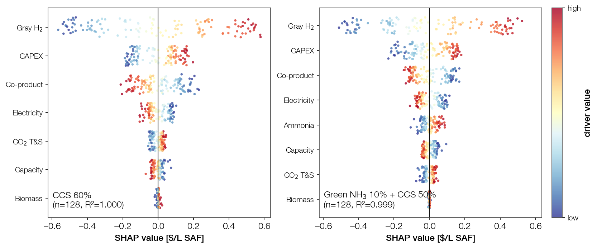
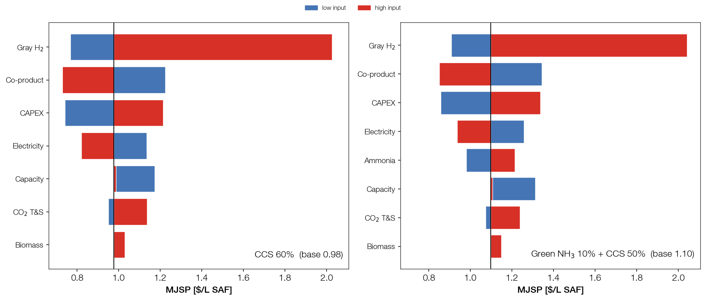
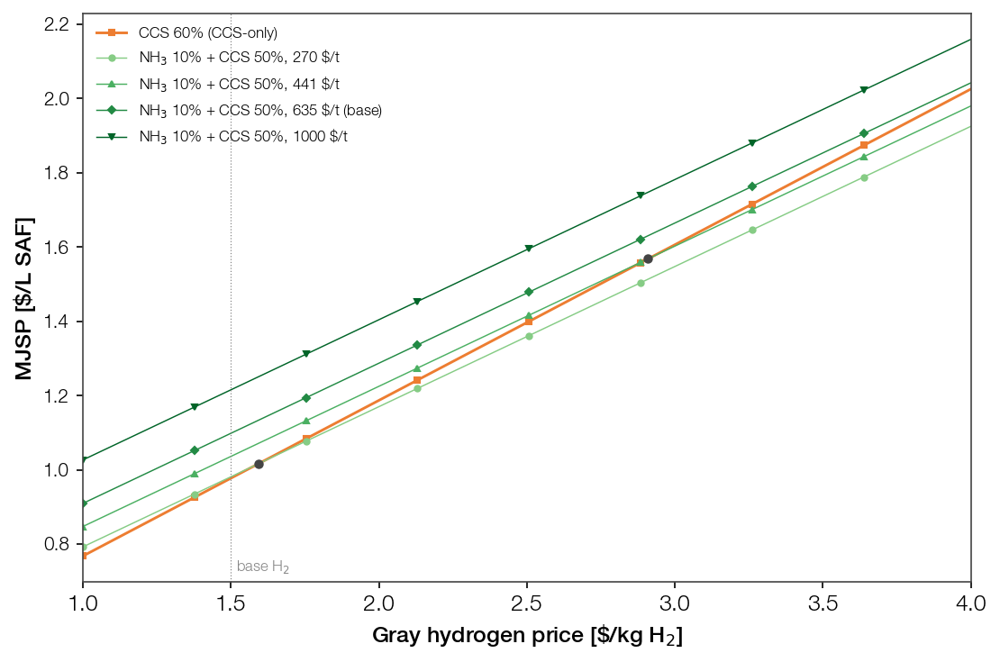

# Tornado Sensitivity Analysis (Reviewer §4.7)

Addresses Critical Review §4.7 ("No sensitivity analysis"), reinforced by §4.5
(ammonia price range) and §8. One-at-a-time MJSP sensitivity over the reviewer's
seven parameters, on the 551 basis, for Base / Full-Ammonia / Full-CCS at scale
×1 and ×30. Driver: `tea_tornado.py` (reuses `funs.TEA`, no engine change).
CO₂ T&S in the CCS unit is costed at a **\$10/tCO₂ basis** (Full-CCS); the T&S bar
sweeps 4–45 \$/tCO₂ around it.

## 1. Method

Each bar perturbs one parameter to the reviewer's low/high end, holding the rest
at base, and records MJSP. Two mechanisms:

- **linear** — the input enters OPEX/CAPEX linearly, so MJSP is post-scaled from
  the single base run (exact; no re-run).
- **re-run** — a scalar knob is set on a fresh `TEA()` and `economic_analysis`
  recomputed (net or non-linear response).

| Parameter | Tornado range | SHAP range (§3–4) | Configs | Mechanism (knob / line) |
|---|---|---|---|---|
| Biomass price | ±50% | 0.0487–0.0527 \$/lb | all | linear — APEA `90BIO` cost (`get_biomass_info`) |
| Gray H₂ price | 1.0–4.0 \$/kg | 1.0–4.0 \$/kg | Base, CCS | linear — APEA H₂ raw-material cost (`hydrogen_feed_stream`) |
| Ammonia price | 0.1225–0.4535 \$/lb | 0.1225–0.4535 \$/lb | Full-Ammonia | linear — feed offset 2.038 \$/L × (p/0.288 − 1) |
| Electricity | ±30% | 13.3–24.8 \$/MMBtu | all | re-run — `elec_price_usd_per_mmbtu` (+ `product_price_work['ELC-']`) |
| Co-product | ±20% | ×0.80–1.20 | all | re-run — `product_price_stream` (316GAS, 336DIES) |
| CAPEX | ±30% | ×0.70–1.30 | all | linear — `df_mjsp['capital investment']` |
| Capacity factor | 85% / 91% | 7446–7972 h/yr | all | re-run — `operation_hr` (0.85/0.91 × 8760) |
| CO₂ T&S | 4–45 \$/tCO₂ | 4–45 \$/tCO₂ | Full-CCS | re-run — `co2_ts_usd_per_ton`; **basis \$10/tCO₂** in CCS |

Configs map to `economic_analysis` as: Base = `['Base'], ccs=0`; Full-Ammonia =
`['Base','Ammonia'], ccs=0` (Ammonia row); Full-CCS = `['Base'], ccs=1.0` (its
`capital investment` already carries CCS CAPEX).

Scope notes (assumptions):
- **Electricity ±30%** rescales the net electricity export revenue (ELC- work
  product) and CCS electricity only; the main-plant purchased-electricity cost
  embedded in the APEA utility sheet is a fixed \$ and is not re-priced.
- **Co-product ±20%** covers the fuel co-products (gasoline, diesel); fertilizer
  co-product (Full-Ammonia, read from the NH₃ APEA) is not re-priced by this bar.
- **Capacity factor**: base is 8000 h = 91.3%; both reviewer endpoints (85%, 91%)
  are below base, so the bar is one-sided (fewer hours → higher MJSP), matching
  the §4.9 concern that 8000 h is optimistic.
- **Biomass range differs between the two analyses.** The tornado uses the reviewer's
  ±50% stress; the SHAP samples the realistic FR-floor→supply-curve band
  (0.0487–0.0527 \$/lb, ~±4%), which is why biomass is scale-robust in the tornado
  but near-zero in the SHAP importance. All other SHAP ranges reuse the tornado
  endpoints; the SHAP samples them jointly (LHS), not one-at-a-time.

## 2. Tornado results

Base MJSP (\$/L SAF):

| Config | ×1 | ×30 |
|---|---|---|
| Base | 1.64 | 0.66 |
| Full-Ammonia | 3.48 | 2.39 |
| Full-CCS | 2.28 | 1.20 |

Ranked drivers (figure: `Figure/tornado.png`; table: `Figure/tornado_sensitivity.xlsx`):

- **Feedstock hydrogen dominates every case.** Gray H₂ price (1–4 \$/kg) is the
  single largest driver for Base and Full-CCS (span ≈ 1.26 \$/L, scale-independent);
  ammonia price (0.12–0.45 \$/lb) dominates Full-Ammonia even more strongly (span
  ≈ 2.34 \$/L), confirming §4.5 that the ammonia-price assumption drives the ranking.
- **CAPEX sensitivity collapses with scale.** CAPEX ±30% is the #2 driver at ×1
  (0.69–0.80 \$/L) but drops to ~0.42–0.49 \$/L at ×30 (six-tenths scaling), falling
  below biomass. Biomass ±50% is scale-robust (~0.62–0.65 \$/L).
- **Electricity and capacity factor are minor** (spans ≤ 0.36 \$/L), so the
  optimistic 8000 h assumption is not a material MJSP risk on its own.
- **CO₂ T&S** sits at a \$10/tCO₂ basis (raising Full-CCS base MJSP by ~0.07 \$/L
  vs. no T&S); sweeping 4–45 \$/tCO₂ moves MJSP within ~0.28 \$/L (scale-invariant),
  below CAPEX and biomass — transport & storage price is not a dominant risk.

Conclusion: MJSP uncertainty is governed by the hydrogen source price (gray H₂ or
ammonia); at commercial scale, feedstock prices outweigh CAPEX. The Full-Ammonia
ranking is contingent on the assumed ammonia price.

## 3. SHAP method (compliance-route drivers)

Distribution-based complement to the one-at-a-time tornado, run on the two competing
CORSIA-compliant points from `_Pareto_Front.md` §7: **CCS 60%** (a=0, c=0.60; the
cheapest CCS-only compliant point, 0.977 \$/L) vs **Green NH₃ 10% + CCS 50%**
(a=0.10, c=0.50; the ammonia-blend compliance floor, 1.098 \$/L). Driver:
`tea_pareto_shap.py` (reuses the `mix_row` MJSP model — same engine re-run + linear
cost terms as the tornado; no engine change).

Per point, over the driver ranges in §1 (SHAP-range column; same as the tornado
except biomass, which uses the realistic supply-curve band rather than ±50%):
Latin-hypercube sample N=128 inputs
(128 real `TEA` calls), fit a gradient-boosted surrogate, then exact TreeSHAP on the
surrogate. TEA is near-additive, so the surrogate tracks it (asserted R² > 0.99);
the surrogate is the only approximation. CCS 60% has 7 drivers (no Ammonia, a=0);
NH₃ 10% + CCS 50% has 8 (Ammonia active on the 10% share). CO₂ T&S sits on the same
\$10/tCO₂ basis as the tornado.

## 4. SHAP results

Mean|SHAP| (\$/L SAF; both surrogate R² > 0.999). Figure:
`Figure/shap_beeswarm_ccs60_vs_nh10ccs50.png`; table: `Result/shap_ccs60_vs_nh10ccs50.xlsx`.

| Driver | CCS 60% | NH₃ 10% + CCS 50% |
|--------|---------|-------------------|
| Gray H₂ | **0.310** | **0.274** |
| CAPEX | 0.104 | 0.102 |
| Co-product | 0.097 | 0.083 |
| Electricity | 0.052 | 0.055 |
| Ammonia | — (a=0) | 0.031 |
| CO₂ T&S | 0.025 | 0.023 |
| Capacity | 0.019 | 0.028 |
| Biomass | 0.003 | 0.002 |

- **Gray H₂ dominates both routes**, consistent with the tornado. CCS 60% leans on
  it harder (0.310 vs 0.274 — 100% grey H₂ vs 90%), and its CO₂ T&S term is slightly
  larger (0.025 vs 0.023, deeper capture). The NH₃ route trades a slice of grey-H₂
  exposure for an Ammonia driver (0.031).
- CAPEX, co-product, and electricity rank next in both, near-identical between the two
  routes. Capacity factor and biomass are negligible — biomass because its SHAP band is
  the narrow supply-curve range (~±4%), not the tornado's ±50% stress (see §1).
- Mean SHAP ≈ 0 for every driver (symmetric input ranges); high H₂ price → +SHAP →
  higher MJSP. Same qualitative message as the tornado: the decarbonization route
  choice does not change what governs MJSP uncertainty — the hydrogen source price.

## 5. OAT tornado over the SHAP ranges (two compliance points)

One-at-a-time complement to the §3–4 SHAP beeswarm: the same two compliance points
(CCS 60%, a=0/c=0.60; Green NH₃ 10% + CCS 50%, a=0.10/c=0.50) and the **SHAP-range**
column of §1 — i.e. biomass on the supply-curve band (0.0487–0.0527 \$/lb), every other
driver at its §1 endpoint. Each bar moves one driver alone, base = all drivers nominal.
Driver: `tea_tornado_shap.py` (reuses `tea_pareto_shap.mjsp_point` / `RANGES` / `POINTS`
and `tea_tornado.tornado`; no engine change). Figure `Figure/tornado_shap_ccs60_vs_nh10ccs50.png`,
table `Result/tornado_shap_ccs60_vs_nh10ccs50.xlsx`.

Base MJSP: CCS 60% = 0.977 \$/L; NH₃10%+CCS50 = 1.098 \$/L. Bar spans (\$/L SAF):

| Driver | CCS 60% | NH₃10%+CCS50 |
|--------|---------|--------------|
| Gray H₂ | **1.258** | **1.133** |
| Co-product | 0.494 | 0.494 |
| CAPEX | 0.472 | 0.480 |
| Electricity | 0.313 | 0.321 |
| Ammonia | — | 0.234 |
| Capacity | 0.188 | 0.205 |
| CO₂ T&S | 0.187 | 0.165 |
| Biomass | 0.052 | 0.052 |

- **Same ranking as the SHAP importance** (§4): Gray H₂ dominates both, biomass negligible.
  The OAT view confirms the beeswarm is not an artifact of joint LHS sampling — the hydrogen
  price governs MJSP one-at-a-time too.
- **Biomass and Capacity bars are one-sided.** Their nominals sit at a range end — biomass at the
  FR floor (SHAP-band low), capacity at the 8000 h base (above both CF endpoints) — so those bars
  extend only one way. Consistent with the §1 biomass-band note and the §4.9 capacity concern.

## 6. Gray-H₂ price crossover of the two compliance routes

MJSP of the two CORSIA-compliant routes against gray-H₂ price (1–4 \$/kg, the §4–5 dominant
driver; base H₂ = 1.50 \$/kg). **CCS 60%** (CCS-only, 100% grey H₂) is the steeper line
(slope **0.419** \$/L per \$/kg, from the §5 Gray-H₂ span 1.258 / 3); **Green NH₃ 10% + CCS 50%**
(90% grey) is shallower (**0.378**, 1.133 / 3) and drawn once per green-ammonia price
(270 / 441 / 635 / 1000 \$/t NH₃). Every MJSP term is linear in its driver (near-additive TEA),
so the lines come straight from the §5 base MJSPs + OAT spans — no re-run.

- The routes cross because they load grey H₂ **differently** (100% vs 90%): the less-exposed NH₃
  route wins at high H₂ price. Crossover H₂ price rises with ammonia price — **1.59 \$/kg** (270 \$/t),
  **2.91** (441), 4.40 (635, base), 7.21 (1000) — so only the two cheapest ammonia cases cross
  inside the 1–4 \$/kg band (dots).
- At base ammonia (635 \$/t) CCS 60% is cheaper across the whole plotted range; the NH₃ blend needs
  green ammonia below ~450 \$/t to undercut CCS 60% within range.
- Grey H₂ is the **only** driver giving an in-range crossover: co-product and CAPEX load both routes
  near-equally (§5 spans ≈ equal), so on those axes the lines are near-parallel and do not cross.

## 7. Literature: breakeven-price claims and their plots

Precedents for "A is costlier, but competitive when price X < (or carbon price >) threshold".
DOIs, numbers and citation counts were checked by a separate fact-checker agent (OpenAlex `cited_by_count`, 2026-10-01).

| ID | Paper | Threshold claim | Supporting plot | Cites |
|----|-------|-----------------|-----------------|-------|
| A1 | Deng 2024, Int. J. Green Energy, 10.1080/15435075.2024.2386066 | NH₃ co-firing breaks even with CCS at \$202/t NH₃ (20% CO₂ cut) and \$189/t (80% cut), at India's 42% capacity factor | Breakeven NH₃ price vs capacity factor (Fig 10); LCOE sensitivity bars (Figs 11–12) | 21 |
| A2 | Cesaro 2021, Appl. Energy, 10.1016/j.apenergy.2020.116009 | Below 25% capacity factor, tipping point at about 400 USD/t NH₃ vs gas, coal or bio-energy with CCS | LCOE bars at 25% capacity factor (Fig 7a); LCOE vs capacity factor (Fig 7b); tornado (Fig 8) | 339 |
| A3 | Fasihi 2021, Appl. Energy, 10.1016/j.apenergy.2020.116170 | Green NH₃ 440–630 €/t (2020), 345–420 €/t (2030) vs fossil 300–350 €/t; gas-price drop offset by about 75 €/tCO₂ by 2040 | Not checked | 473 |
| A4 | Egerer 2023, Appl. Energy, 10.1016/j.apenergy.2023.120662 | Green reaches parity with gray NH₃ at moderate gas prices if the CO₂ price is high enough; cracking back to H₂ adds 45% | Not checked | 127 |
| A5 | Bachorz 2025, Nat. Commun., 10.1038/s41467-025-59277-1 | Steel breakeven H₂ cost €50/MWh (retrofit, incomplete mitigation), €150/MWh (retrofit, full mitigation), €230/MWh (new plant); aviation €300–1000/tCO₂ | 2-D least-cost map, H₂ cost × non-fossil CO₂ feedstock cost (Fig 3); MAC curve (Fig 6) | 29 |
| C1 | Ueckerdt 2021, Nat. Clim. Change, 10.1038/s41558-021-01032-7 | E-fuel breakeven CO₂ price 800 €/t (e-gasoline) and 1200 €/t (e-methane) for 2020–25; 280–1200 €/t over 2020–2030; about 20–270 €/t by 2050 | Fuel cost vs CO₂ price, crossovers circled (Fig 4c); breakeven over time vs scenario price paths (Fig 4d) | 704 |
| C2 | Parkinson 2019, Energy Environ. Sci., 10.1039/c8ee02079e | Mitigation cost vs SMR: about \$70/tCO₂ (methane pyrolysis), about \$140/tCO₂ (coal gasification + CCS); electrolysis needs H₂ below \$2.5–3/kg | Mitigation-cost dot chart with error bars (Fig 4) | 585 |
| C3 | Sanchez 2018, PNAS, 10.1073/pnas.1719695115 | \$60/t sequestration credit gives 30 Mt CO₂ stored and 6,900 km of pipeline; \$90/t abatement credit gives 38 Mt | Supply curves at stepped credit levels (Fig 2) | 169 |
| C4 | Lu 2019, PNAS, 10.1073/pnas.1812239116 | Coal–biomass gasification with CCS (CBECCS) competitive above \$52/t CO₂ vs pulverized coal and \$42/t vs coal IGCC | LCOE vs carbon price lines (Fig 3A); breakeven contour map, biomass price × mixing ratio (Fig 3C) | 138 |
| C5 | Freire Ordóñez 2022, Sustain. Energy Fuels, 10.1039/d2se00757f | E-jet needs a carbon tax of at least 1125 USD/t CO₂-eq | Carbon-tax chart (Fig 8) | 33 |
| C6 | Rojas Michaga 2022, Energy Convers. Manage., 10.1016/j.enconman.2022.115346 | BECCS jet: MJSP 3.03→3.27 £/kg with CCS; breaks even with RTFO certificates (0.20 £) plus a carbon price of 246.64 £/tCO₂ | Not checked | 100 |
| C7 | Becattini 2021, Ind. Eng. Chem. Res., 10.1021/acs.iecr.0c05392 | Fossil jet + biogenic point-source CCS cost-competitive with fossil jet + carbon tax today (abstract only) | Not checked | 153 |
| C8 | Gautam 2023, PNAS, 10.1073/pnas.2312667120 | Soil-carbon credit of \$185/tCO₂ makes Miscanthus biojet competitive on 66% of US cropland at \$0.74/L (16% without the credit) | Grid of US maps, credit level × jet price (Fig 2) | 26 |
| C9 | Langholtz 2026, iScience, 10.1016/j.isci.2026.115956 | Biomass value for carbon removal (BiCRS) rises above about \$200/tCO₂; SAF cost \$2.48–2.91/L, quoted from another source | Two panels shaded by biomass value, fuel price × carbon price (Fig 2) | 1 |

Plot types used for this kind of claim, most to least common:
1. Cost vs price line plot with a crossover marker against the baseline (C1 Fig 4c, C4 Fig 3A, A2 Fig 7b). Same form as `plot_ammonia_crossover.py`.
2. Two-price contour or heatmap with breakeven lines or least-cost regions (C4 Fig 3C, A5 Fig 3, C9 Fig 2).
3. Breakeven price plotted against a third driver, such as capacity factor or year (A1 Fig 10, C1 Fig 4d).
4. Tornado or Monte Carlo as supporting evidence; these rarely show the threshold themselves.
5. MAC or supply curves, for \$/tCO₂ claims across technologies (A5 Fig 6, C3 Fig 2, C2 Fig 4).

None of these papers gives an ammonia-price threshold for H₂ used in SAF or hydrotreating.

## Log history

### 2026-10-02

**Discussion**
- User asked for a version of the §6 gray-H₂ crossover figure with CO₂ T&S cases added. It was built as three panels (T&S 4 / 10 / 45 \$/tCO₂; the \$10 panel is the original §6 figure). User judged it **not very useful**, so it stays out of the report body; §6 keeps the single-panel figure. Do not propose it again as a §6 figure.
- What it showed: T&S moves the crossovers by at most ~0.45 \$/kg H₂ (lower at \$45/t, because CCS-only stores more CO₂). At \$45/t the base-ammonia (635 \$/t) crossover moves into the plotted range at 3.95 \$/kg. Shift method: the two routes' §5 CO₂ T&S spans (0.187 / 0.165 \$/L over 4–45 \$/t), no re-run.

**Code**
- `plot_ammonia_crossover_ts.py` (new): three-panel T&S variant of `plot_ammonia_crossover.py` that imports that script's anchors and saves `Figure/ammonia_crossover_ts_mjsp.png`. Self-check: the \$10 panel reproduces the original, and dearer T&S lowers every crossover.

**Open**
- None.

### 2026-10-01 (update 2)

**Discussion**
- User asked for reference papers that conclude "A is expensive but becomes cheaper when X price drops below a threshold", and for the plot types they use. Scope chosen: ammonia-price and carbon-price/CCS thresholds. Results are in §6.
- One survey agent found 14 papers; a separate fact-checker agent then checked them against OpenAlex and the full texts. All DOIs and numbers were confirmed and none were wrong. Fixes taken from the check: A5 has three breakeven cases and its Fig 3 axis is non-fossil CO₂ cost; C1's 280–1200 range covers 2020–2030; C9's SAF cost is quoted from another source; A2 and C2 are cited by issue year (2021, 2019).
- Dropped as having no confirmed breakeven: Emenike 2021, Schreuder 2025, Kim 2020, Brown 2011, Makhloufi 2021.

**Code**
- None.

**Open**
- Plot types not checked for A3, A4, C6, C7 (publisher blocked access); C7 checked against abstract only.
- No ammonia-price threshold for SAF/hydrotreating H₂ found in the literature; Google Scholar not searched.

### 2026-10-01

**Discussion**
- User asked for a **graph format** showing that as green-ammonia price falls, the ammonia route
  beats the CCS-only route. Chose a **crossover line plot** (x = ammonia price, y = MJSP): CCS-only
  is flat (no ammonia), the NH₃ route rises linearly, they cross. Metric = MJSP (not GHG/abatement).
- Routes = the two CORSIA-compliant §5 points: **CCS 60%** (0.977 \$/L, flat) vs **Green NH₃ 10% +
  CCS 50%** (1.098 \$/L at base price). No new TEA run — the NH₃-route MJSP is exactly linear in
  ammonia price (offset = 10% × 2.038 \$/L × (p/0.288 − 1)), so anchors come straight from §5.
- Result: **crossover ≈ 0.117 \$/lb = 258 \$/t NH₃**, just below the reviewer's price floor
  (0.1225 \$/lb = 270 \$/t). So the ammonia blend undercuts CCS-only only at green-NH₃ prices below
  the reviewer's low end — a narrow but real window.
- **Reframed the figure (same day):** user asked to put **gray-H₂ price on the x-axis** (the dominant
  driver, §4–5) and draw **one NH₃ line per green-ammonia price**. Keeps MJSP but makes the crossover
  a 2-D story: CCS 60% is now a *sloped* line (100% grey, slope 0.419 \$/L per \$/kg from the §5 Gray-H₂
  span 1.258/3) and the NH₃ route is shallower (90% grey, 0.378 from 1.133/3), so the two cross *within*
  the 1–4 \$/kg range only when ammonia is cheap. Base grey-H₂ = **1.50 \$/kg** (APEA raw-material cost).
  Crossover H₂ price falls as ammonia cheapens: **270 \$/t → 1.59 \$/kg**, 441 → 2.91 (both in-range),
  635 (base) → 4.40, 1000 → 7.21 (both above range). Supersedes the flat-CCS / ammonia-x-axis framing above.

- **Co-product x-axis tried, dropped as a crossover view (same day):** user felt the gray-H₂ lines looked
  "too linear" and asked to try **co-product price on the x-axis**. Result: the §5 co-product OAT span is
  **identical for both routes (0.494 \$/L** — shared co-product streams + same SAF output), so both lines
  have the *same* slope → CCS 60% and every NH₃ line are **parallel and never cross**. Whether an NH₃ line
  beats CCS 60% is set only by ammonia price (the fixed 0.121 \$/L base gap → ammonia below ~258 \$/t),
  independent of co-product. So co-product does **not** yield a crossover story and is still linear.
  Root cause of "too linear": the TEA is near-additive — every driver enters MJSP linearly, so no single-
  driver x-axis curves. Only a driver the two routes load *differently* crosses: gray H₂ (slopes 0.419 vs
  0.378) and ammonia (NH₃ has it, CCS does not). Co-product is shared, hence parallel. Kept the gray-H₂
  figure as the crossover view.
- Promoted the gray-H₂ crossover figure into the report body as a new **§6** (conclusion-level: model,
  crossover H₂ prices, the "only grey H₂ crosses in-range" reading). The **Literature** section moved
  **§6 → §7**. The "update 2" line above ("Results are in §6") now refers to **§7** (left unedited per
  the no-edit-old-entries rule). Also added line markers (distinct shape per series) to the figure on
  user request. CAPEX x-axis evaluated analytically (slopes 0.787 vs 0.800, gap 0.013 → crossover
  off-scale except the 270 \$/t line grazing the band edge at ×0.71) and **not** plotted — same
  near-parallel outcome as co-product.

**Code**
- `plot_ammonia_crossover.py` (new, committed `7226981`) — crossover plot → `Figure/ammonia_crossover_mjsp.png`.
  Anchors from §5 (base MJSPs + recorded Gray-H₂/Ammonia OAT spans → slopes; no re-run). **Revised same day** to
  x = gray-H₂ price (1–4 \$/kg): CCS 60% one sloped reference line, NH₃ 10%+CCS50 one line per ammonia
  price (270/441/635/1000 \$/t), green shades light→dark, dots marking in-range crossovers with CCS 60%,
  base-H₂ marker. SA_RC applied, png only. Self-check: CCS slope > NH₃ slope, cheaper ammonia pulls the
  crossover to lower H₂ price.
- `plot_coproduct_crossover.py` (new, uncommitted) — co-product-price variant → `Figure/coproduct_crossover_mjsp.png`.
  Same anchors; co-product enters as a revenue credit (slope −1.235 \$/L per ×, same both routes). Shows the
  parallel/no-crossover result above; caveat documented in the module docstring. Self-check: NH₃-vs-CCS
  ordering constant across the co-product sweep (parallel ⇒ no crossover).

**Open**
- Crossover (258 \$/t) sits just under the reviewer range floor (270 \$/t); figure extends the x-axis
  ~20% below the floor to show it. If a within-range story is wanted, would need a lower NH₃ share or a
  deeper CCS pairing. Uncommitted as of this entry.

### 2026-09-30

**Discussion**
- User asked to add an **OAT sensitivity over the SHAP ranges** (option **A**: replace the tornado's
  biomass ±50% bar with the SHAP supply-curve band; every other SHAP range already equals the tornado
  endpoint per §1), for the **two SHAP-analysis points** (CCS 60%, NH₃10%+CCS50), compared in subplots.
  Option B (keep both biomass bars) dropped — user chose A. Purpose: a one-at-a-time cross-check of the
  §4 SHAP importance on identical points/ranges, to show H₂-price dominance is not a joint-sampling artifact.
- User asked to SHAP the **CCS 60%** point (the CCS-only CORSIA-compliant point established in
  `_Pareto_Front.md` §7) and show it **beside the previous SHAP run** (Green NH₃ 10% + CCS 50%) as
  two subplots. Setting + results logged here per this session's split target (CCS60 TEA/LCA in
  `_Pareto_Front.md`, SHAP here).
- Purpose: contrast the driver structure of the two competing compliance routes — CCS-only (CCS60,
  0.977 \$/L) vs the ammonia-blend floor (NH₃10%+CCS50, 1.098 \$/L).

**Code**
- `tea_tornado_shap.py` (new) — OAT tornado for the two SHAP points over the SHAP ranges (§5). Reuses
  `mjsp_point`/`RANGES`/`POINTS` from `tea_pareto_shap` and `tornado()` from `tea_tornado`; base =
  drivers at nominal (`NOMINAL`, each nominal zeroes its term or is the engine default). Two subplots,
  shared x → `Figure/tornado_shap_ccs60_vs_nh10ccs50.png` + `Result/…xlsx`. Ranking matches the beeswarm
  (Gray H₂ span ~1.2 \$/L both; biomass ~0.05, one-sided). Self-checks: base>0, CAPEX monotone.
- `tea_pareto_shap.py` — `POINTS` gains `'CCS 60%'` (a=0, c=0.60) ahead of the NH₃10%+CCS50 case;
  CCS60 has **7 drivers** (no Ammonia, since a=0). `main()` already n-panel — renders both as a
  side-by-side beeswarm. Outputs renamed `Figure/shap_beeswarm_ccs60_vs_nh10ccs50.png` +
  `Result/shap_ccs60_vs_nh10ccs50.xlsx`. Cache (`Result/shap_samples.npz`) self-invalidated on the
  POINTS-set change → full LHS resample (128 pts × 2 points).
- Report body: SHAP method + results promoted from log into new sections **§3 (SHAP method)** and
  **§4 (SHAP results)** so the body holds current state (per CLAUDE.md); log keeps the process only.
- §1 parameter table: added a **SHAP range** column (renamed Range→Tornado range). Surfaced that
  SHAP biomass uses the FR-floor→supply-curve band 0.0487–0.0527 \$/lb (~±4%), not ±50% — corrects
  the earlier "same ranges" wording and explains biomass's near-zero SHAP vs scale-robust tornado bar.
  All other SHAP ranges match the tornado endpoints (sampled jointly by LHS). Body \$ escaping fixed.
- **Result** (mean|SHAP| \$/L; both surrogate R² > 0.999, TEA near-additive):

  | Driver | CCS 60% | NH₃10%+CCS50 |
  |--------|---------|--------------|
  | Gray H₂ | **0.310** | **0.274** |
  | CAPEX | 0.104 | 0.102 |
  | Co-product | 0.097 | 0.083 |
  | Electricity | 0.052 | 0.055 |
  | Ammonia | — (a=0) | 0.031 |
  | CO₂ T&S | 0.025 | 0.023 |
  | Capacity | 0.019 | 0.028 |
  | Biomass | 0.003 | 0.002 |

- **Reading**: Gray H₂ dominates both. CCS60 leans on it *harder* (0.310 vs 0.274 — 100% grey H₂ vs
  90%), and its CO₂ T&S term is slightly larger (0.025 vs 0.023, deeper capture). The NH₃ route swaps
  a slice of grey-H₂ exposure for an Ammonia driver (0.031). Mean SHAP ≈ 0 for every driver (symmetric
  input ranges); high H₂ price (red) → +SHAP → raises MJSP. Same qualitative message as the tornado.

**Open**
- CCS60 GHG (the point's LCA basis) is interpolated, not GREET-sampled — see `_Pareto_Front.md` §7.
- ₂/₃ render via `mlabel()` mathtext (fine); prior `shap_beeswarm_nh10_ccs50.*` outputs superseded by
  the `_vs_` files (old files left in place). Uncommitted as of this entry.

### 2026-09-29 (update 2)

**Discussion**
- New `_Pareto_Front` version picks the compliance floor dynamically (cheapest-MJSP compliant point;
  KR-mix threshold makes CCS25-alone non-compliant). User set the SHAP target to that new floor:
  **Green NH₃ 10% + CCS 50%** (a=0.10, c=0.50), and asked for SHAP on this single case only.
  The earlier CCS25-vs-NH₃25 comparison is dropped from the script (figure/xlsx stay committed).

**Code**
- `tea_pareto_shap.py` — `POINTS` reduced to the single a=0.10/c=0.50 case (8 drivers: all of
  gray-H₂ + ammonia + CO₂ T&S active). `main()` generalized to n panels (squeeze=False + ravel);
  cache now key-checks against `POINTS` so it self-invalidates when the case changes. New outputs
  `Figure/shap_beeswarm_nh10_ccs50.png` + `Result/shap_nh10_ccs50.xlsx`.
- Result (surrogate R²=0.9993): Gray H₂ dominates (mean|SHAP| 0.274 — 90% of H₂ still grey), then
  CAPEX 0.102, Co-product 0.083, Electricity 0.055, Ammonia 0.031 (small 10% share), Capacity 0.028,
  CO₂ T&S 0.023 (up from 0.010 at CCS25, as expected at CCS50), Biomass ~0.
- figsize made panel-count aware: single panel 7×4.5 landscape (near-square looked cramped),
  multi-panel 5.5×4.5 per panel.
- Subscript tofu fixed: `mlabel()` helper rewrites ₂/₃ to mathtext (`$_2$`/`$_3$`) at render time
  (y-labels + title), so H₂/CO₂/NH₃ show correctly without the SA_RC font glyphs. Render-only —
  data keys/cache untouched. (Other project figures with unicode subscripts still tofu; not touched.)

**Open**
- New anchor taken from the user's instruction; not cross-checked against the regenerated
  `Result/pareto_front.xlsx` dynamic floor. Single-case changes uncommitted as of this entry.

### 2026-09-29

**Discussion**
- Log target for this and future sessions moved here (`_Tornado_Sensitivity.md`) from
  `_Pareto_Front.md`. Earlier 2026-09-29 SHAP work is logged there (updates 4–6); summarized
  below for future reference.

**SHAP summary (past work, source: `_Pareto_Front.md` updates 4–6)**
- Goal: MJSP driver attribution for the two ~25%-decarbonization frontier points —
  grey-H₂ + CCS 25% (a=0, c=0.25) vs Green NH₃ 25% (a=0.25, c=0), same §4.7 driver ranges
  and MJSP model as the tornado (`mix_row` engine re-run + linear cost terms).
- Method evolved across the session:
  1. Two-panel MJSP **tornado** comparison of the two points (`Figure/tornado_ccs25_vs_nh325.png`).
  2. **Exact KernelSHAP** on the TEA function, single instance per point (all-low → all-high
     corner, 2⁷ coalitions enumerated, contributions sum to the swing). Bar + scatter figures.
  3. Reviewer wanted >100 sampled points → switched to **Latin-hypercube (N=128/point) +
     gradient-boosted surrogate + TreeSHAP beeswarm** (`tea_pareto_shap.py`). 128 real TEA calls
     per point; SHAP exact on the surrogate, guarded by `assert R²>0.99` (TEA is near-additive).
- Key finding: **feedstock H₂ price dominates both routes.** Grey+CCS25 — Gray H₂ \$+1.26/L ≫
  CAPEX \$+0.48, Co-product \$−0.49; CO₂ T&S only \$+0.11 (minor lever). Green NH₃ 25% — H₂ bill
  splits Gray H₂ \$+0.94 + Ammonia \$+0.59, sitting on a higher MJSP floor (worst-case
  \$2.19/L vs \$1.87/L for CCS25). (Single-instance exact numbers; beeswarm means in
  `Result/shap_ccs25_vs_nh325.xlsx`.)
- Artifacts: `tea_pareto_shap.py`; `Figure/shap_beeswarm_ccs25_vs_nh325.png` (current);
  `Figure/shap_ccs25_vs_nh325.png` + `shap_scatter_ccs25_vs_nh325.png` (earlier exact bar/scatter,
  now superseded). Added deps: `shap`, and reuses `scipy.stats.qmc` + `sklearn`.

**Code**
- Beeswarm run completed: surrogate R²=0.9995 (CCS25) / 0.9993 (NH₃25). Importance (mean|SHAP|,
  \$/L): CCS25 — Gray H₂ 0.312 ≫ CAPEX 0.103, Co-product 0.095, Electricity 0.058, Capacity 0.020,
  CO₂ T&S 0.010, Biomass 0.004. NH₃25 — Gray H₂ 0.226, Ammonia 0.125, CAPEX 0.100, Co-product 0.093,
  Electricity 0.057, Capacity 0.026, Biomass 0.004. Mean SHAP ≈ 0 for all (symmetric ranges).
  Directionality sanity: high H₂ price (red) → +SHAP → raises MJSP.

**Code**
- Colorbar overlap fixed: root cause was `SA_RC`'s `figure.autolayout=True` fighting `fig.colorbar`;
  switched the beeswarm figure to `constrained_layout=True` (autolayout off for this fig) and moved
  panel titles bottom-left. Added an npz sample cache (`Result/shap_samples.npz`) so cosmetic replots
  skip the ~13-min resample (delete the npz to refresh).
- Beeswarm figsize reduced 14×6 → 9×4.5 (fonts too small at the larger size).

**Open**
- Colorbar overlapped the right-panel title text (cosmetic) — RESOLVED (see Code above). Subscript
  ₂/₃ still render as tofu boxes (SA_RC font). SHAP code changes uncommitted as of this entry.

### 2026-09-27

**Discussion**
- New session for the §4.7 sensitivity request. User chose: log to a **new** file
  (this one, not `_Base_Revision.md`/`_Scale_Up_Sensitivity.md`); cover **Base,
  Full-Ammonia, Full-CCS** at scale **×1 and ×30** (6 tornados).
- Configuration set to Base/Full-Ammonia/Full-CCS rather than the Mix case; the
  Mix option was offered (only case with both grey H₂ and ammonia) but not chosen.
- Optional CO₂ T&S bar on Full-CCS left out by default to match the reviewer's
  seven-item list.
- Update (same session): user then requested the CO₂ T&S bar be added to
  Full-CCS; first added as a $0-base bar ($4–45/tCO₂).
- Update (same session): user set a **$10/tCO₂ basis** for CO₂ T&S in the CCS
  unit. T&S now baked into the Full-CCS base run (via `co2_ts_usd_per_ton=10`);
  Full-CCS base MJSP 2.21→2.28 (×1), 1.13→1.20 (×30). Sensitivity report
  `_Scale_Up_Sensitivity.md` explicitly excludes T&S; `_Scale_Up_Subunits.md`
  numbers updated to the same $10/t basis.

**Code**
- `tea_tornado.py` — new driver; per (config, scale) computes base MJSP and the
  §4.7 bars (seven; Full-CCS also gets an eighth CO₂ T&S bar), writes
  `Figure/tornado.png` (3×2 grid, shared x-axis) and `Figure/tornado_sensitivity.xlsx`. Reuses `funs.TEA.economic_analysis`;
  ammonia-price constants copied from `tea_scale_up_abatement.py` (single source
  of truth). Linear bars derived from the base run; electricity/co-product/capacity
  re-run on a fresh `TEA()` with the knob set.
- Verified engine before wiring: `main_h2_demand` is lb/hr and H₂ cost is not
  returned, so the driver reads the APEA `RawMaterial Summary` directly (same query
  as `get_main_wo_h2`) to get the base gray-H₂ price; `product_price_work['ELC-']`
  is a copied float at `__init__`, so the electricity re-run sets it explicitly
  alongside `elec_price_usd_per_mmbtu`.
- Bug: console `UnicodeEncodeError` (cp949 can't encode `–`/`…`/`₂` in the printed
  labels). Cause: Windows default console codec. Fix: `sys.stdout.reconfigure(encoding='utf-8')`.
- Self-check (in `__main__`): base MJSP > 0, biomass/CAPEX bars straddle base, and
  capacity re-run moves MJSP — all pass.
- CO₂ T&S: `TS_BASE=10` set on the CCS base run and on every Full-CCS re-run
  (`rerun_knob` applies it before knobs); the T&S bar re-runs at 4/45 $/tCO₂.
  Engine `calc_cost_CCS` applies it on `co2_seq` — matches the abatement-script def.

**Open**
- Electricity bar does not re-price APEA-embedded main-plant electricity (fixed $);
  fertilizer co-product not covered by the co-product bar. Documented as scope, not
  yet quantified.
